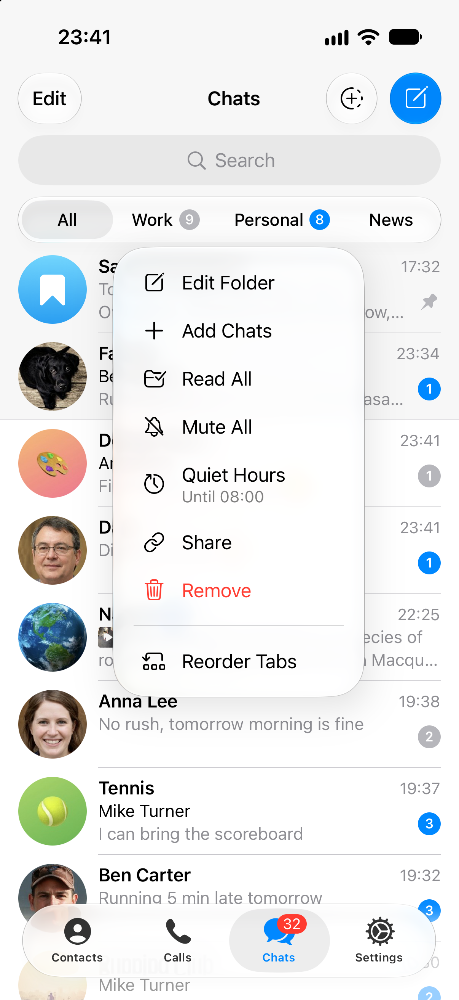
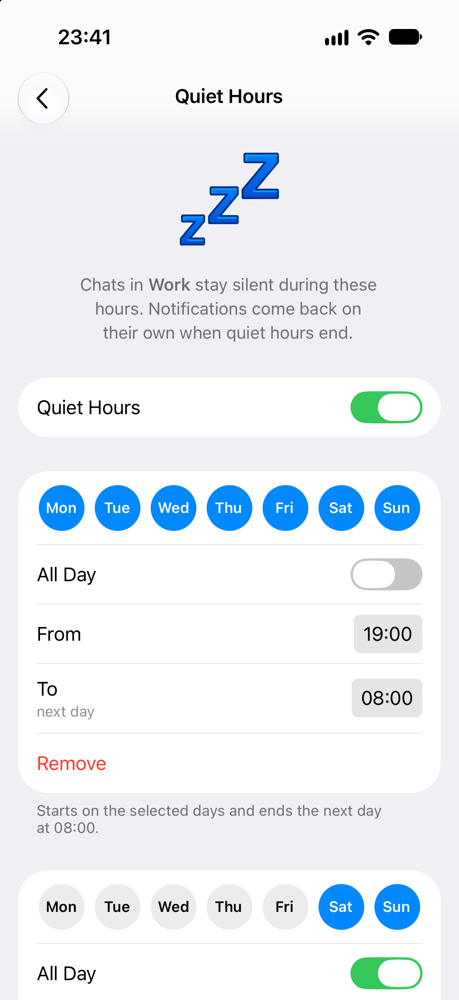

# Quiet Hours for chat folders in Telegram iOS

Quiet hours keep a chat folder silent on a weekly schedule: **Work** goes quiet in the evenings and on weekends, and
every other chat rings as usual. Notifications come back on their own when quiet hours end.

**Demo:** [`demo.mp4`](demo.mp4), the real app in the iOS simulator: one take, cut only where the screen is still.

<p>




</p>

The folder tab's menu, the Quiet Hours screen, a second set for the weekend, and the chat list during quiet hours:
Work's badges are gray and its message arrived without a sound or banner, while Dad's, in Personal, rang as usual.

**Mute All** in the folder tab's menu mutes a folder until it is unmuted by hand. A folder mute that ends by itself or
follows a schedule is requested in [bugs.telegram.org/c/2411](https://bugs.telegram.org/c/2411); Quiet Hours sits
next to Mute All.

## Try it

The change is one patch against [Telegram-iOS](https://github.com/TelegramMessenger/Telegram-iOS) at
`fb0e62ba` (22 October 2026): 27 files, a new schedule module with its tests, a new screen, and small hooks in the
folder menu, Edit Folder, the chat list, in-app notifications and the notification service extension.

```sh
git clone --recursive https://github.com/TelegramMessenger/Telegram-iOS && cd Telegram-iOS
git checkout fb0e62ba8a147f0821da6aa63c09da7d79a10111
git apply /path/to/folder-quiet-hours.patch
# then build as usual, for example for the simulator with the repository's fake code signing
# (config.json holds your api_id and api_hash, as in build-system/template_minimal_development_configuration.json):
python3 build-system/Make/Make.py build --configurationPath=config.json \
  --codesigningInformationPath=build-system/fake-codesigning --buildNumber=1 --configuration=debug_sim_arm64
```

How it is built, the decisions and the limits are in [`docs/folder-quiet-hours.md`](#how-it-works), which the patch
adds to the repository and which is repeated below.

## How it was checked

- **Schedule math:** 16 unit tests, among them 1,536 schedules checked at every minute of the week against what a
  window means, and the next change compared with a minute-by-minute walk across six time zones around the 2026 clock
  changes.
- **Which chats go quiet:** `ChatListFiltersInclusionTests` in TelegramCore: chat types, included, excluded and
  pinned chats, archived chats, chats a folder hides as muted or read, secret chats, a chat in several folders.
- **Folder rules:** an exhaustive run inside the app on a real account: 2,048 folder rules and 400 pairs of folders
  against Postbox's own folder lists, 73,440 checks, no mismatches between the folder tab, the silence and the gray
  badges ([`verification/`](verification/)).
- **By hand, with real messages,** each recorded: a chat only in a quiet folder (silent), only in another folder
  (banner), in two folders with one quiet (silent everywhere), a mention in a quiet group, a folder by chat type with an
  excluded and a pinned chat, a chat added to or taken out of a quiet folder from another device, a quiet folder
  deleted, quiet hours switched off in the middle of a window, the app restarted in the middle of one, a window ending
  while the app is open, dark mode.

---

<a id="how-it-works"></a>
## The flow

1. Press and hold a folder tab. The menu has **Quiet Hours** right after **Mute All**. Its second line says where they stand: *Until 08:00* while quiet hours are on, *From 19:00* while they are off (with the weekday when that is a day or more away). The same goes into the folder's **Edit Folder** row.
2. The Quiet Hours screen (also reachable from **Edit Folder → Quiet Hours**):
   - a switch;
   - the days, as a row of buttons;
   - **All Day**, or **From** and **To** picked with the app's time-of-day wheel. A window may run past midnight: *From 19:00 To 08:00* ends the next morning, and the screen says so;
   - **Add a Set of Hours** (the Business Hours wording) adds another window; turning quiet hours on creates the first. A new set starts as *All Day* with no days chosen: picking *Sat* and *Sun* makes the weekend quiet. A set left without days is not saved.
3. Leaving the screen saves it, and a toast confirms: *Quiet hours for **Work**: Every Day, 19:00 – 08:00; Weekends, All Day*. Opened from **Edit Folder**, the change waits for **Done** like the folder's other settings, and **Cancel** drops it.
4. While quiet hours are on, the folder's chats stay silent: no sound, vibration or banner in the app, pushes go straight to Notification Center without sound or banner, and their unread badges and the folder tab's badge turn gray like a muted folder's, without the mute icon. Unlike a mute, mentions and replies are silent too.

## How it works

Quiet hours never change a chat's notification settings: its mute, its exceptions in Settings → Notifications and how it looks on other devices stay as they are. While a window is on, the folder's chats behave as if muted:

| Piece | Where |
| --- | --- |
| Weekly windows and their math (days, overnight windows, all day, next change, daylight saving) | `submodules/FolderNotificationSchedule/Sources/FolderNotificationSchedule.swift` |
| Stored settings: each folder's quiet hours | `submodules/TelegramUIPreferences/Sources/ChatListFolderNotificationScheduleSettings.swift` |
| Whether a folder shows a given chat, by its rules (`chatListFiltersIncludePeer`, from the database: `_internal_chatListFiltersIncludePeer`); the folder rules themselves (`chatListFilterPredicate`, moved here from ChatListUI so the extension can use them) | `submodules/TelegramCore/Sources/TelegramEngine/Peers/ChatListFiltering.swift` |
| Whether a chat is quiet now (`FolderNotificationScheduleManager.isQuiet`), which folders are (`folderNotificationScheduleActiveFolderIds`) | `submodules/ChatListUI/Sources/FolderNotificationScheduleManager.swift` |
| The Quiet Hours screen, the day buttons, the schedule text | `submodules/TelegramUI/Components/Settings/FolderNotificationScheduleScreen/` |
| The folder tab menu item, the toast, the gray tab badge | `ChatListController.swift`, `ChatListControllerFolderNotificationSchedule.swift` |
| The gray unread badge of a quiet chat (`isQuiet`, checked per row like the folder tags) | `ChatListNode.swift`, `ChatListItem.swift` |
| The Edit Folder row | `ChatListFilterPresetController.swift` |
| No sound or banner in the app | `submodules/TelegramUI/Sources/ApplicationContext.swift` (in-app notifications) |
| Silent pushes | `Telegram/NotificationService/Sources/NotificationService.swift`; for another account's push while the app is open, `AppDelegate.swift` |

**Which chats.** Whether a message's chat is in a quiet folder is decided when the message arrives, from the database, by the folder's own rules: its chat types, included and excluded chats, archived chats when the folder includes them, and its pinned chats wherever they are, as the folder shows them. Being muted or read does not take a chat out, so a folder that shows only unread chats keeps its quiet hours for all of them. Nothing is precomputed, so a chat that has just joined a folder through its rules (a stranger writing to a *Non-Contacts* folder, a new group in *Groups*) is quiet from its first message.

**Chats in several folders.** A chat is quiet while quiet hours are on in *any* of its folders, the way **Mute All** of one folder already silences a chat that is also in another. The opposite rule (quiet only when all of its folders are quiet) was rejected: folders such as *Personal* built from the *Contacts* category contain most work contacts too, so work chats would keep ringing after hours.

**Pushes.** The Notification Service Extension, which runs for every Telegram push, reads the schedules in the database transaction it already opens, checks the chat against the quiet folders' rules (before it fetches the message, and again after, for a chat the device did not know yet) and delivers the push without sound or banner (`.passive`), straight into Notification Center. Telegram's own build carries the `com.apple.developer.usernotifications.filtering` entitlement and could drop such a push entirely.

**Time.** Quiet hours follow the device's clock, like alarms and Focus: 19:00 stays 19:00 after traveling or a clock change.

## Why not mute the chats

The first version set the server mute on each chat for the length of the window and gave the old setting back afterwards. It was dropped: it made folders that hide muted chats go empty in the evening, filled Settings → Notifications → Exceptions, showed chats as muted on every device, sent one request per chat twice a day, and had to restore each chat's previous setting. With server support (below) the server would not send these pushes at all.

## Limits of the prototype

- **The schedule lives on this device**, and only this device keeps quiet hours. The server has no notification settings for folders, so Telegram Desktop and other phones of the account still notify.
- A single chat cannot yet be exempted from its folder's quiet hours (for example a chat that is also in *Family*); taking it out of the folder does it.
- The app icon badge and the Chats tab counter still count the quiet chats' unread messages: Postbox counts them by the chats' mute settings, which quiet hours do not change.
- A chat list row does not know whether its chat is archived. In a folder tab that also shows archived chats, an archived chat's badge follows the rules for unarchived chats, as Telegram's folder tags do, and so do the topics of an archived forum; their notifications follow where the chat really is. Chat search results keep the usual badge colors.
- A folder tab's badge turns gray for the folder's own quiet hours. A folder that is not quiet itself keeps a blue badge even if all of its unread chats are quiet through another folder.
- Pushes are kept silent by the notification service extension. If iOS does not run it at all, the push shows as the server sent it; story notifications are not covered.
- Quiet hours are kept by folder id. If another device deletes a folder and creates a new one under the same id while this app is not running, the new folder inherits them.

## Production path

Store the schedule with the folder on the server (for example a `quiet_hours` field in `dialogFilter`, reusing the `businessWorkHours` / `businessWeeklyOpen` types Telegram Business already has) and let the server skip pushes for the folder's chats during the windows, on every device. The client pieces above stay: the screen, the menu item, the Edit Folder row and the gray badge do not change, and the manager becomes the offline fallback. Android and Desktop already have the same folder tab menu with **Mute All** (`FilterMuteAll` in `DialogsActivity.java`, `chat_filters_tabs_strip.cpp`).

## Tests

- `submodules/FolderNotificationSchedule/Tests`, 16 tests: 1,536 schedules checked at every minute of the week against what a window means (every set of days with every kind of window, starts and ends at the edges of the day and the hour); same-day and overnight windows, all-day, week wrap, unions of windows; the next change compared with a minute-by-minute walk across six time zones around the 2026 clock changes; windows that begin or end right where the clocks change (including Santiago, Scoresbysund and Lord Howe, whose clocks change at midnight, at 23:00 or by half an hour); decoding damaged values.
- `submodules/TelegramCore/Tests/ChatListFiltersInclusionTests.swift`: which chats a folder's quiet hours silence: chat types, included, excluded and pinned chats, archived chats, muted and read chats staying in, secret chats by their user, a chat in several folders.
- Bazel: `./build-input/bazel-9.2.0-darwin-arm64 test //submodules/FolderNotificationSchedule:FolderNotificationScheduleTests` (host) and `//submodules/TelegramCore:TelegramCoreTests` (simulator).
