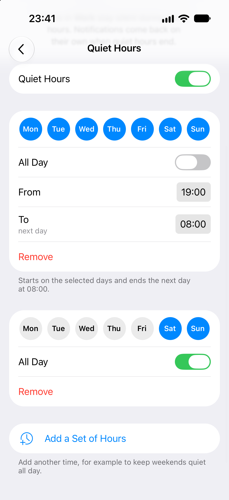
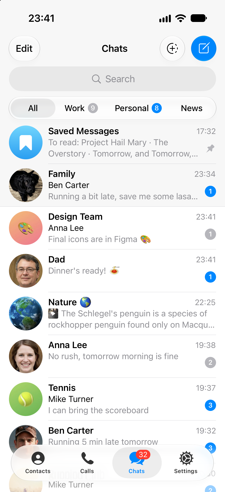

# Quiet Hours for chat folders

A weekly schedule for a chat folder: **Work** stays silent in the evenings and on weekends, while every other chat
notifies as usual. Notifications come back on their own when quiet hours end.

A patch for Telegram-iOS, with tests. ▶︎ [Demo video](https://github.com/sternblut/telegram-folder-quiet-hours/raw/main/demo.mp4): the real app in the iOS simulator, 32 s.

<p>




</p>

## Why

**Mute All** in the folder tab's menu silences a folder until it is unmuted by hand. Muting a folder for a set time
was asked for in 2024 on the card where Mute All was requested
([bugs.telegram.org/c/2411](https://bugs.telegram.org/c/2411)). A schedule goes one step further: nobody wants to
remember to mute Work every evening and unmute it every morning.

## What it does

- **Quiet Hours** sits in the folder tab's menu, right after **Mute All**, and in **Edit Folder**. Its second line
  says where things stand: *Until 08:00* or *From 19:00*.
- A folder can have several sets of hours. Each has its days and either **From** and **To** or **All Day**, and may
  run past midnight. *Every Day, 19:00 – 08:00* plus *Sat, Sun, All Day* covers evenings and weekends.
- While a set is on, the folder's chats make no sound, vibration or banner, in the app and in pushes. Their unread
  badges and the folder tab's badge turn gray, as for a muted folder.
- The chats' own notification settings are never changed: mutes, exceptions and other devices stay as they are.
- A chat that is in several folders is quiet while any of them is, the way **Mute All** already works.

## Code

- `FolderNotificationSchedule`, a new module: the schedule itself, with days, overnight windows, all day, the next
  change and clock changes. Foundation only, with host tests.
- The settings in `TelegramUIPreferences`: each folder's quiet hours, stored on the device.
- `ChatListFiltering` in TelegramCore: whether a folder's rules include a chat. The app and the notification
  extension share it.
- `FolderNotificationScheduleManager` in ChatListUI: whether a chat is quiet now, and which folders are.
- `FolderNotificationScheduleScreen`: the Quiet Hours screen, built like Business Hours.
- `ChatListController`, `ChatListFilterPresetController`, `ChatListNode`, `ChatListItem`: the menu item, the Edit
  Folder row and the gray badges.
- `ApplicationContext`, `NotificationService`, `AppDelegate`: no banner in the app, and pushes delivered `.passive`.

`docs/folder-quiet-hours.md`, added by the patch, describes the design and every limitation.

## Apply

The patch is against [Telegram-iOS](https://github.com/TelegramMessenger/Telegram-iOS) at `fb0e62ba` (22 October 2026).

```sh
git clone --recursive https://github.com/TelegramMessenger/Telegram-iOS && cd Telegram-iOS
git checkout fb0e62ba8a147f0821da6aa63c09da7d79a10111
git submodule update --init --recursive
git apply /path/to/folder-quiet-hours.patch
```

Then build as usual.

## Limitations

- The schedule lives on the device, so the account's other devices still notify. With server support it would be a
  field of `dialogFilter`, like `businessWorkHours`, and the server would not send the pushes.
- The app icon badge still counts unread messages in quiet chats.
- A single chat cannot yet be exempted from its folder's quiet hours.

## Tests

- `FolderNotificationScheduleTests`, run on the host: the schedule, minute by minute and across clock changes.
- `ChatListFiltersInclusionTests` in `TelegramCoreTests`: which chats a folder's quiet hours cover.
- [`verification/`](verification/): an in-app check of every folder rule against Telegram's own folder lists.
